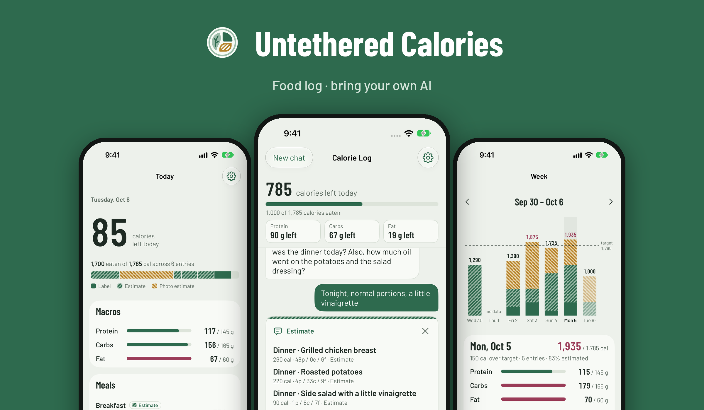

<p align="center">
  <picture>
    <source media="(prefers-color-scheme: dark)" srcset="docs/images/hero-dark.png">
    
  </picture>
</p>

<h1 align="center">Untethered Calories</h1>

<p align="center"><a href="https://github.com/Untethered-Citizens/untethered-calories/actions/workflows/ci.yml"></a></p>

<p align="center"><b>Food log · bring your own AI</b><br>
A calorie and macro tracker for iPhone where logging is a conversation, not a form.</p>

<p align="center">
  No accounts · No ads, analytics or tracking · No subscription
</p>

---

## Just say what you ate

Type it, dictate it, or take a photo. The app turns "two eggs and toast, and a latte" into logged entries with calories, protein, carbs and fat. It uses Claude, through **your own AI key**.

- **Numbers you give are logged straight away.** Tell it "protein bar, label says 210 cal, 20 g protein…" or photograph a nutrition label, and it's saved at once.
- **Estimates are proposed and wait for you.** For a home-cooked dinner or a restaurant plate, you get an estimate card. Accept it with one tap, or edit it first.
- **It asks when it needs to.** If a portion or a cooking oil matters, it asks a short question instead of guessing.
- **"How much have I got left?"** is answered on the phone itself, without calling the AI.

## Honest about where every number came from

Every entry is marked as one of three sources, and the charts show them differently:

| Source | Meaning |
|---|---|
| **Label** | You gave the numbers, or they were read from a nutrition label |
| **Estimate** | Claude's estimate from your description |
| **Photo estimate** | Claude's estimate from a photo of the food |

An estimate is never upgraded to look like a label. Each day also shows how much of it was estimated ("83% estimated"), so you know how firm the numbers are.

## A dashboard that does the maths on your phone

- **Today:** calories left, a protein/carbs/fat breakdown, and your meals. Swipe to edit or delete.
- **Week:** a bar for each day against your target, split by source, plus averages.
- **Weight:** read from Apple Health, with a 7-day average.
- **Trend:** intake and weight side by side, and what the two say together.

Totals, averages and charts are plain on-device code, with no AI involved. Days you didn't log are treated as gaps, never as zero, and today isn't counted in averages until it's over.

## Bring your own AI

The app has no server and no subscription. Instead, you paste your own Anthropic API key once:

- The key is stored in the iOS **Keychain** on your phone.
- Your messages and food photos go **straight from your phone to Anthropic**, under your own account. They don't pass through anyone else.
- Anthropic bills you directly for what you use. That's usually **less than a cent to a couple of cents per entry** (a photo costs a little more). Settings → Usage and cost shows what you've spent.
- You choose the Claude model in Settings.

Your food log and settings stay on your iPhone.

## Requirements

- iPhone with **iOS 26** or later
- An Anthropic API key ([console.anthropic.com](https://console.anthropic.com)). The app walks you through getting one.
- Optional: Apple Health, for weight

## Status

Version 1.0 has been submitted to the App Store, where it will be free. This repository is the app's source code.

## Building from source

1. Install the latest **Xcode** on a Mac.
2. Clone this repository and open `CalorieTracker.xcodeproj`.
3. Choose the **CalorieTracker** scheme and an iPhone simulator, then press **⌘R**.

To run the tests from the command line:

```bash
xcodebuild -project CalorieTracker.xcodeproj -scheme CalorieTracker -destination 'platform=iOS Simulator,name=iPhone 17' test
```

No API key is needed to build or run the tests. Add your own key in the app's Settings to try logging. Never commit a key.

## Contributing

Bug reports and ideas are welcome. Please open an issue first and agree the change before opening a pull request. [CONTRIBUTING.md](CONTRIBUTING.md) explains the process, and [ARCHITECTURE.md](ARCHITECTURE.md) explains how the code is organised and the rules it follows. To report a security problem, see [SECURITY.md](SECURITY.md).

## More

- Website: [untetheredcalories.com](https://untetheredcalories.com/)
- [Privacy policy](https://untetheredcalories.com/privacy/)
- [Help and support](https://untetheredcalories.com/support/)

## Credits

Made by [Untethered Citizens](https://github.com/Untethered-Citizens), tools for living on your own terms.

The app uses the [Barlow](https://github.com/jpt/barlow) and Barlow Condensed typefaces by The Barlow Project Authors, under the SIL Open Font License 1.1 (`CalorieTracker/Resources/Fonts/OFL.txt`).

## Licence

The code is licensed under the [Apache License 2.0](LICENSE). The name "Untethered Calories", the app icon and the Untethered Citizens branding are not covered by the licence. If you publish your own version, please give it a different name and icon.
